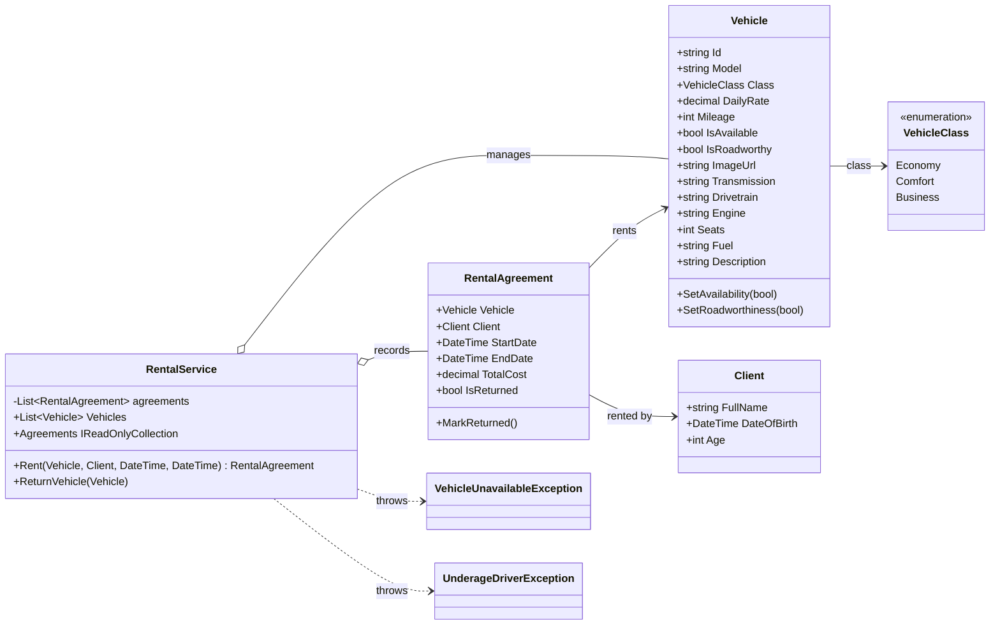

# DriveRental

Вебзастосунок для перегляду автопарку та бронювання автомобілів. Реалізований на ASP.NET Core Razor Pages (.NET 10).

## Запуск

```powershell
dotnet run --project .\CarRentalWeb.csproj
```

Після запуску відкрийте адресу, яку покаже `dotnet run` (зазвичай `https://localhost:7xxx` або `http://localhost:5xxx`).

## Можливості

- Каталог автомобілів із фото та характеристиками.
- Бронювання з перевіркою мінімального віку водія, пробігу та доступності авто.
- Розрахунок вартості оренди та знижка для оренди понад 7 днів.
- Список бронювань із клієнтом, автомобілем, періодом, вартістю і статусом.
- Повернення автомобіля з оновленням статусу бронювання.

Дані бронювань зберігаються в пам’яті процесу і очищуються після перезапуску застосунку.

## Діаграма класів


